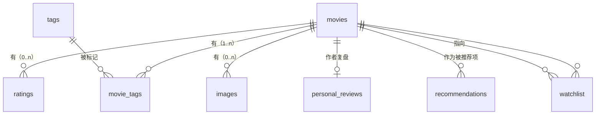

# 数据库结构（8 张表）

本项目 v1 **不需要数据库**：数据以 JSON 文件落地（`data/catalog.json` 等），页面在服务端读取构建。
本文档把 JSON 的字段定义成 8 张表的关系模型，目的是：

1. 让数据契约有明确的字段边界（每张表的字段、约束、来源都可追溯）；
2. 需要迁移到 Postgres/SQLite 时，可以直接照这份 DDL 落地，不用重新设计。



> 命名约定：JSON 用 camelCase（`chineseTitle`），SQL 用 snake_case（`chinese_title`），
> 两者在 `scripts/merge-catalog.mjs` 的映射里一一对应。

---

## 1. `movies` — 作品

唯一事实表。一行 = 一部电影或剧集。

```sql
CREATE TABLE movies (
  id                text PRIMARY KEY,            -- 稳定机读 id，如 harry-potter-and-the-philosophers-stone
  slug              text NOT NULL UNIQUE,        -- URL 用，与 id 一致但独立
  chinese_title     text NOT NULL,
  original_title    text NOT NULL,
  release_year      integer NOT NULL CHECK (release_year BETWEEN 1900 AND 2100),
  media_type        text NOT NULL CHECK (media_type IN ('movie','series')),
  format            text NOT NULL CHECK (format IN ('live_action','animation')),
  franchise         text,                        -- 系列机器名，可空
  franchise_name    text,                        -- 系列中文名，可空
  series_order      integer,                     -- 系列内序号，来自原始片单，不猜测
  country           text[] NOT NULL DEFAULT '{}',-- ISO 3166-1 alpha-2
  directors         text[] NOT NULL DEFAULT '{}',
  cast              text[] NOT NULL DEFAULT '{}',
  runtime_minutes   integer CHECK (runtime_minutes > 0),
  seasons           integer CHECK (seasons > 0), -- series 专用
  original_language text,                        -- ISO 639-1
  synopsis          text NOT NULL,               -- 本站原创，≥60 汉字
  recommendation    text NOT NULL,               -- 编辑推荐语
  audience_fit      text NOT NULL,
  audience_mismatch text NOT NULL,
  tag_confidence    text NOT NULL CHECK (tag_confidence IN ('high','medium','low')),
  watch_status      text NOT NULL DEFAULT 'unknown'
                    CHECK (watch_status IN ('watched','rewatched','want_to_watch','dropped','unknown')),
  creator_note      text,                        -- 创作者原话，未提供时为 NULL，不补写
  wikidata_id       text,                        -- 来自 enrichment
  imdb_id           text,                        -- 来自 enrichment
  record_file       text NOT NULL,               -- 原始记录文件名（可追溯）
  needs_review      boolean NOT NULL DEFAULT false,
  review_reasons    text[] NOT NULL DEFAULT '{}',
  created_at        timestamptz NOT NULL DEFAULT now(),
  updated_at        timestamptz NOT NULL DEFAULT now(),
  CONSTRAINT synopsis_not_short CHECK (char_length(synopsis) >= 60)
);

CREATE INDEX movies_year_idx ON movies (release_year);
CREATE INDEX movies_franchise_idx ON movies (franchise, series_order);
```

对应 JSON：`data/catalog.json → movies[]`。

---

## 2. `ratings` — 评分（严格 7 字段契约）

**这是本项目最严格的一张表**：只有一个数字的"评分"不允许存在。

```sql
CREATE TABLE ratings (
  id              bigserial PRIMARY KEY,
  movie_id        text NOT NULL REFERENCES movies(id) ON DELETE CASCADE,
  source          text NOT NULL,                 -- 如 'IMDb'
  rating_value    numeric(3,1) NOT NULL CHECK (rating_value > 0),
  rating_scale    smallint NOT NULL CHECK (rating_scale IN (5,10)),
  rating_count    integer CHECK (rating_count >= 0),
  last_checked_at timestamptz NOT NULL,
  source_url      text NOT NULL CHECK (source_url ~ '^https?://'),
  usage_status    text NOT NULL,                 -- free / personal-noncommercial-attribution-required
  CONSTRAINT value_within_scale CHECK (rating_value <= rating_scale),
  UNIQUE (movie_id, source)
);
```

不变量：

- `rating_count` 没有就留 `NULL`，**不允许估**；
- `rating_scale` 必须显式声明，禁止把 `8.1/10` 和 `4.1/5` 混算；
- `usage_status` 必填，页脚据此决定是否显示署名；
- 本项目**不写入豆瓣评分**。

对应 JSON：`movies[].ratings[]`；另有派生视图 `editorialScore()`（0–100，编辑推荐度）——
它是"编辑推荐度"，不是评分，且明确向用户说明。

---

## 3. `tags` — 标签词典

```sql
CREATE TABLE tags (
  id         text PRIMARY KEY,        -- 词表 id，如 magic-academy / 魔法学院
  label_zh   text NOT NULL,
  label_en   text,
  category   text NOT NULL CHECK (category IN ('type','world','aesthetic','element','mood','exclude')),
  note       text
);
```

词表是**封闭集合**：不在词表里的标签会在导入时被剔除并写进 `import-report.json`，
这是避免"标签通胀"（每个作品一套自造标签）的关键约束。
完整词表见 `lib/vocabulary.ts` 与 `docs/CATALOG_RECORD_SCHEMA.md`。

---

## 4. `movie_tags` — 作品 × 标签（带来源与置信度）

```sql
CREATE TABLE movie_tags (
  movie_id      text NOT NULL REFERENCES movies(id) ON DELETE CASCADE,
  tag_id        text NOT NULL REFERENCES tags(id),
  tag_source    text NOT NULL DEFAULT 'human' CHECK (tag_source IN ('human','ai-assist','imported')),
  tag_model     text,           -- AI 标注时必填（当前全部为 human，故为 NULL）
  tag_prompt_version text,      -- AI 标注时必填
  confidence    text NOT NULL CHECK (confidence IN ('high','medium','low')),
  review_status text NOT NULL DEFAULT 'approved' CHECK (review_status IN ('approved','pending','rejected')),
  PRIMARY KEY (movie_id, tag_id)
);
```

规则：`tag_source = 'ai-assist'` 的行默认 `review_status='pending'`，
**未审核的 AI 标签不进入推荐计算**（`lib/recommend.ts` 只读 `approved`）。
当前 58 部作品全部是人工标注（`human` / `approved`）。

---

## 5. `images` — 封面与素材（含授权状态）

```sql
CREATE TABLE images (
  id            text PRIMARY KEY,
  movie_id      text REFERENCES movies(id) ON DELETE CASCADE,
  kind          text NOT NULL CHECK (kind IN ('generated','official','placeholder')),
  generator     text,            -- 如 'fantasy-atlas/procedural-svg-v1'
  license       text NOT NULL,   -- 'site-original' / 'licensed' / 'public-domain'
  license_note  text,
  source_url    text,
  attribution   text,
  width         integer,
  height        integer,
  created_at    timestamptz NOT NULL DEFAULT now()
);
```

当前 100% 是 `kind='generated'`、`license='site-original'`：
没有获得任何电影海报授权，所以不用官方物料，改用 `<Poster>` 组件按分类配色 + 作品种子
确定性生成的抽象 SVG。详情页会逐条声明"不是官方海报"。

---

## 6. `personal_reviews` — 作者的个人记录（与客观资料分离）

```sql
CREATE TABLE personal_reviews (
  movie_id     text PRIMARY KEY REFERENCES movies(id) ON DELETE CASCADE,
  personal_rating smallint CHECK (personal_rating BETWEEN 1 AND 5),  -- 与 ratings 完全分离
  note         text,
  favorite     boolean NOT NULL DEFAULT false,
  watched      boolean NOT NULL DEFAULT false,
  updated_at   timestamptz NOT NULL DEFAULT now()
);
```

v1 的实例存在浏览器 localStorage（键 `fantasy-atlas:library:v1`），
结构与本表一致，因此将来接账号系统时可以直接迁移。
**个人评分永远不参与任何外部评分的平均**。

---

## 7. `watchlist` — 待看清单

```sql
CREATE TABLE watchlist (
  movie_id  text PRIMARY KEY REFERENCES movies(id) ON DELETE CASCADE,
  added_at  timestamptz NOT NULL DEFAULT now(),
  priority  smallint CHECK (priority BETWEEN 1 AND 3),
  note      text
);
```

对应前端 `/favorites` 的「待看」标签页。

---

## 8. `recommendations` — 推荐记录（可回放）

```sql
CREATE TABLE recommendations (
  id                bigserial PRIMARY KEY,
  created_at        timestamptz NOT NULL DEFAULT now(),
  movie_id          text NOT NULL REFERENCES movies(id) ON DELETE CASCADE,
  rank              integer NOT NULL,
  score             numeric(6,2) NOT NULL,
  strength          smallint NOT NULL CHECK (strength BETWEEN 0 AND 100),
  weights_version   text NOT NULL,        -- 权重版本，便于复现历史结果
  preferences_json  jsonb NOT NULL,       -- 当时的口味输入
  reasons_json      jsonb NOT NULL,       -- 逐条加分理由
  caution_json      jsonb NOT NULL        -- 劝退提示
);
```

v1 的推荐在浏览器里实时计算、不落库；本表是"要存档/回放时才用"的结构。
`weights_version` 让"为什么当时推了这部"可以被复查 —— 这是可解释性的最低要求。

---

## JSON ↔ 表映射一览

| JSON 位置 | 表 |
| --- | --- |
| `data/catalog.json → movies[]` | `movies` + `movie_tags` + `ratings` + `images`（拆解后） |
| `data/raw/catalog-*.json` | 人工编辑的原始记录（导入来源，只增不改） |
| `data/derived/enrichment.json` | `movies` 的外部字段 + `ratings` 的来源 |
| `data/reports/import-report.json` | 导入审计日志（被拒/重复/待复核） |
| `lib/vocabulary.ts` | `tags` 的种子数据 |
| localStorage `fantasy-atlas:library:v1` | `personal_reviews` + `watchlist`（浏览器端实例） |
| 运行时内存 | `recommendations`（不落库） |

## 迁移到 Postgres 的步骤（将来）

1. 执行上面 8 段 DDL；
2. `node scripts/merge-catalog.mjs` 产出 `data/catalog.json`；
3. 写一个一次性 `scripts/import-to-pg.mjs`（约 100 行）把 `movies/ratings/movie_tags` 展开插入；
4. 把 `lib/data.ts` 的 `loadCatalog()` 换成 SQL 查询即可 —— 组件层不用改（都依赖 `Movie` 类型）。
